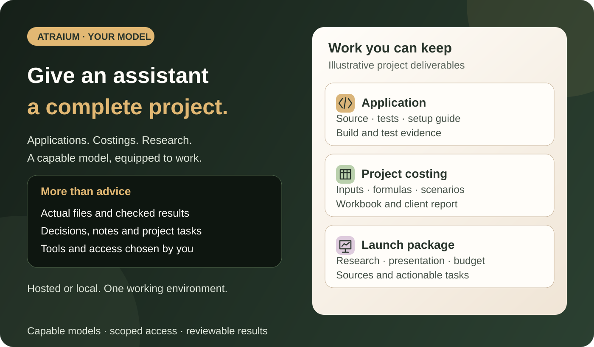
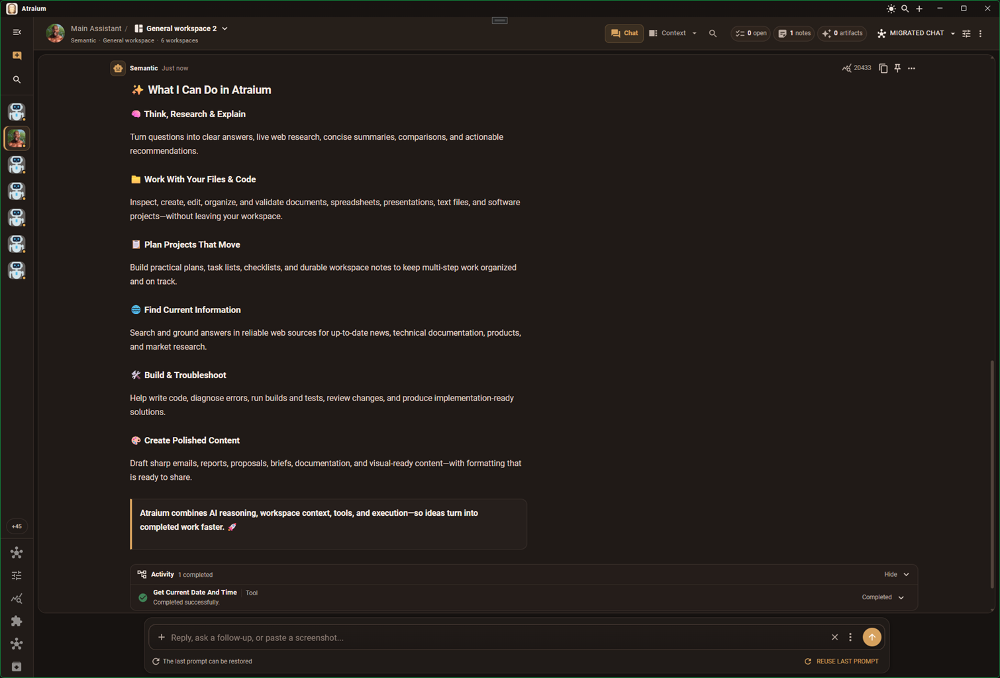

# Atraium Preview



**Bring your own model. Give an assistant a project—not just a question.**

Atraium gives an assistant the tools and working environment to act as an **independent worker**. Give it a brief to build an application, produce a complete project costing or prepare a research-backed launch package. With a capable model and the right access, it can make routine decisions, create files, check results, repair problems and deliver the finished work—not just describe what you should do next.

Hosted and local models connect to coding, research and document tools, with conversations, notes, tasks and deliverables kept in project workspaces. You choose the model, the responsibility and the access.

For projects with several workstreams, **Supervisor workspaces** let an assistant create focused workers, collect their results and bring the work together. Workers can coordinate teams of their own when you allow it, with shared limits and visible assignment progress.

**New in 0.6.0 Preview 1: Skills.** Keep reusable methods and checklists, request guidance for one message, and turn a useful response into a reviewed workflow draft. [Read the release notes](release-notes/v0.6.0-preview.1.md).

[Download](#download) · [Get started](GETTING-STARTED.md) · [Skills](docs/skills.md) · [Work delegation](docs/supervisor-workspaces.md) · [Connect a model](docs/model-setup.md) · [Documentation](docs/README.md) · [Official website](https://atraium.com)

## What would you delegate?

**A working application:** “Build an internal service-desk app with staff login, ticket management, a dashboard and tests. Create the project in the approved folder, build it, fix failures and include setup documentation.” [Complete application example](docs/use-cases.md#build-a-complete-application-from-a-brief).

**A complete project costing:** “Use these scope documents, quantities, labour rates and supplier prices to produce an auditable workbook, risk scenarios and a client-facing PDF. Reconcile the totals and flag missing information.” [Costing example and sample inputs](docs/use-cases.md#produce-a-complete-project-costing).

**A launch package:** “Turn this product brief into a sourced market assessment, positioning, a presentation and a launch plan. Retain editable deliverables and record the decisions.” [Launch package example](docs/use-cases.md#prepare-a-complete-launch-package).

Pair the work with a suitable model: **GPT-6 Astra**, **GPT-6.1 Sol**, **Claude Opus/Sonnet 5.5**, or a locally hostable coding model such as **KAT-Coder-V2.5-Dev**. These are options, not a promise of identical results; API mode, tool support, context and permissions matter. [Model choices and independent work](docs/independent-assistants.md#choose-a-model-for-the-responsibility).

## Why choose Atraium?

Atraium brings **model choice, reusable assistant roles, visible project records and coding/business tools into one app**. A software project can have its implementation, costing, research and client handover in separate workspaces, with different instructions and models where useful.

Codex and Claude Code also perform autonomous work. Choose Atraium when you want this integrated, multi-provider workspace experience across software and business deliverables—not because autonomy belongs to only one product. [How Atraium fits](docs/independent-assistants.md#why-choose-atraium-for-this-work).

## One project, a coordinated team

**Introduced in 0.5.0 Preview 1:** enable **Supervisor delegation** in Workspace settings to divide a project into focused assignments within the same Room. Each worker has its own conversation and saved work; the Supervisor reviews the results and produces the combined outcome.

For example, ask for separate read-only reviews of a repository's tests and documentation, then one prioritised report with evidence and follow-up tasks. For larger projects, **Allow nested Supervisors** lets a workstream lead organise its own specialists.

- **Follow the work:** inspect the assignment hierarchy, open worker workspaces and review returned results.
- **Set shared limits:** control team size, nesting depth, concurrent model work, request counts and duration.
- **Stay in control:** resume work paused for your input, or stop an assignment and the team working under it. Completed actions are not undone.

Delegation does not create a file sandbox or a provider spending cap. Assign non-overlapping file responsibilities, review important results and keep provider-side budgets in place.

[Start a delegated project](docs/supervisor-workspaces.md#start-your-first-delegated-project) · [Try a team review](docs/use-cases.md#coordinate-a-repository-review-with-a-team)

## Skills: keep your methods ready

**In 0.6.0 Preview 1**, create a writing style, research method or release checklist in **Settings → Skills**, or import a trusted Agent Skills ZIP. Add it to a Room or workspace and choose **When relevant**, **Only when requested** or **Off**.

Request guidance for just the next message with the compact **Skills** picker. A removable version-labelled chip stays separate from your typed question. Save a completed response with **Message actions → Save this workflow as a Skill**, edit the preview into a repeatable method and review the draft before making it available.

Keep the same approach across projects, or share the right guidance with each specialist in a Supervisor team. Improve your Skills as you work; existing projects keep their chosen version until you decide to update them.

[Skills guide](docs/skills.md) · [Share guidance with specialists](docs/supervisor-workspaces.md#share-skills-with-specialists)

## Download

The latest public release is **[0.6.0 Preview 1](https://github.com/daemosofchaos/Atraium-Preview/releases/tag/v0.6.0-preview.1)**. Windows is the recommended preview experience; Android is an early sideloaded preview.

| Package | Choose this when… |
|---|---|
| [Windows x64 installer](https://github.com/daemosofchaos/Atraium-Preview/releases/download/v0.6.0-preview.1/Atraium-0.6.0-preview.1-win-x64-setup.exe) | You want a normal installation for your Windows account. |
| [Windows x64 portable ZIP](https://github.com/daemosofchaos/Atraium-Preview/releases/download/v0.6.0-preview.1/Atraium-0.6.0-preview.1-win-x64-portable.zip) | You want to extract the application and run it without an installer. |
| [Android APK](https://github.com/daemosofchaos/Atraium-Preview/releases/download/v0.6.0-preview.1/Atraium-0.6.0-preview.1-android.apk) | You want to sideload on an Android 7.0+ arm64-v8a device or x86_64 emulator. |
| [Android preview ZIP](https://github.com/daemosofchaos/Atraium-Preview/releases/download/v0.6.0-preview.1/Atraium-0.6.0-preview.1-android-preview.zip) | You want the same APK with the preview, privacy, security and billing documents. |
| [SHA-256 checksums](https://github.com/daemosofchaos/Atraium-Preview/releases/download/v0.6.0-preview.1/Atraium-0.6.0-preview.1-SHA256SUMS.txt) | Verify the package before installing or running it. |

[All releases](https://github.com/daemosofchaos/Atraium-Preview/releases) · [What's new in 0.6.0](release-notes/v0.6.0-preview.1.md) · [Installation instructions](GETTING-STARTED.md#install-atraium)

> **Bring-your-own-model means bring-your-own account or server.** Atraium does not include model downloads, API keys or credits. A ChatGPT, Claude or Gemini consumer subscription is not necessarily an API account. You are responsible for provider and infrastructure charges; set provider-side spending limits before adding a paid key. See [Billing](TOKEN-USAGE-AND-BILLING.md).

## Your first assistant

1. Install Atraium and create a model profile in first-run setup.
2. Assign that profile to **Chat**. **Utility** is optional and uses Chat for supporting work when no ready Utility profile is assigned; images, voice and web grounding can wait.
3. Create a Room for your assistant and use its Main workspace for your first task.
4. Try this request:

```text
Help me plan a four-week website refresh for a small consulting firm, with one
available developer. Save a short project brief as a workspace note and create
three next-step tasks. Identify assumptions; do not browse or edit files.
```

Open **Notes** and **Tasks** to review the saved work. This is a quick setup check, not the limit of what you can delegate. Follow the [quick start](GETTING-STARTED.md) for installation and connection details, then try an [end-to-end project](docs/use-cases.md).

## Choose your model setup

| What you have | Start here |
|---|---|
| OpenAI API account | [OpenAI setup](docs/model-setup.md#openai) |
| Anthropic API account | [Claude setup](docs/model-setup.md#anthropic-claude) |
| Google AI Studio API key | [Gemini setup](docs/model-setup.md#google-gemini) |
| Azure OpenAI deployment | [Azure setup](docs/model-setup.md#azure-openai) |
| A PC that can run local models | [LM Studio or Ollama](docs/local-models.md) |
| An OpenAI-compatible hosted or self-hosted endpoint | [Custom endpoint setup](docs/model-setup.md#other-openai-compatible-services) |
| Android with a model server on another computer | [Connect your phone to a server](docs/local-models.md#use-a-server-from-android-or-another-computer) |

You can save several profiles and choose a different model for a Room or Workspace. Provider, model and tool-calling compatibility varies; start with a small task before granting file or application access.

## What can you do with Atraium?

| Use case | Useful result |
|---|---|
| [Build a complete application](docs/use-cases.md#build-a-complete-application-from-a-brief) | A working project, build/test evidence, setup instructions and a handover. |
| [Cost a complete project](docs/use-cases.md#produce-a-complete-project-costing) | An auditable workbook, budget comparison, risk scenarios and a client PDF. |
| [Prepare a launch package](docs/use-cases.md#prepare-a-complete-launch-package) | A sourced assessment, positioning, presentation and actionable launch plan. |
| [Coordinate a team review](docs/use-cases.md#coordinate-a-repository-review-with-a-team) | Focused worker findings, a checked combined report and clear follow-up tasks. |
| [Research a purchase](docs/use-cases.md#compare-products-with-current-sources) | A sourced comparison, clear limitations and a saved recommendation. |
| [Plan a project](docs/use-cases.md#turn-meeting-notes-into-a-project-plan) | An editable brief, decisions and next-step tasks. |
| [Understand a CSV](docs/use-cases.md#explore-a-csv-and-create-a-chart) | Checked totals, an inline chart and reusable data. |
| [Create a client report](docs/use-cases.md#create-a-client-ready-pdf) | A styled PDF and retained HTML source for revisions. |
| [Review a code project](docs/use-cases.md#review-a-small-code-project) | Findings tied to files, followed by changes only when requested. |
| [Prepare a handover](docs/use-cases.md#save-a-handover-without-regenerating-it) | Exact saved message text and original document/image files. |
| [Create campaign artwork](docs/use-cases.md#generate-one-campaign-image) | A requested image using a separately configured image model. |



## Keep work organized

- **Model profile:** a reusable provider connection, model and settings.
- **Room:** the home for an assistant's role, instructions and default model/tools.
- **Workspace:** one project inside a Room, with its own conversation, notes, tasks and artifacts.

For example, a Business Room can have separate workspaces for a website refresh, supplier research and monthly reporting. Saved notes and tasks keep the important work easy to find; you can edit them yourself.

[Rooms, workspaces and tools](docs/workspaces-and-tools.md) explains templates, model overrides and access controls.

## Add capabilities when you need them

One working Chat profile is enough to start. Assign a separate Utility profile only if you want another text model for supporting work. Add **Brave Search** for current web research, an image model for artwork, or specialized profiles for memory, speech and realtime interaction. Those services have their own account, access and cost requirements.

Built-in tools cover documents, files, research, code and supported device actions. Broader tool catalogs are available through a searchable **Gateway**; selected tools can be **Direct**. Neither route grants file permission. Compatible MCP servers can add tools, but should be treated as trusted integrations with real access—not as harmless prompts.

[Model setup](docs/model-setup.md) · [Images and voice](docs/images-and-voice.md) · [Documents and exports](docs/documents-and-exports.md)

## Preview and safety

- Windows x64 and Android packages are available. There are no public Web, macOS or iOS packages in this release.
- Preview software is not a production guarantee. Keep backups and review important output.
- Atraium is local-first, not automatically offline. Configured services receive the content needed for their requests.
- Local tools can affect real files and applications. Begin with limited access and non-sensitive data.
- Download only from the official website or this repository's Releases page, and verify the checksum.

[Preview scope](PREVIEW.md) · [Privacy](PRIVACY.md) · [Security](SECURITY.md) · [Billing](TOKEN-USAGE-AND-BILLING.md) · [Binary preview terms](BINARY-PREVIEW-TERMS.md)

## Help and feedback

Check [Troubleshooting](docs/troubleshooting.md) for connection, installation and tool problems. For a reproducible bug or focused suggestion, use [GitHub Issues](https://github.com/daemosofchaos/Atraium-Preview/issues) and follow the [support guide](SUPPORT.md). Remove credentials and private content from reports.

This repository contains the public preview downloads, documentation and feedback channels, not the Atraium application source. Any future public source release and its licence will be announced separately.
